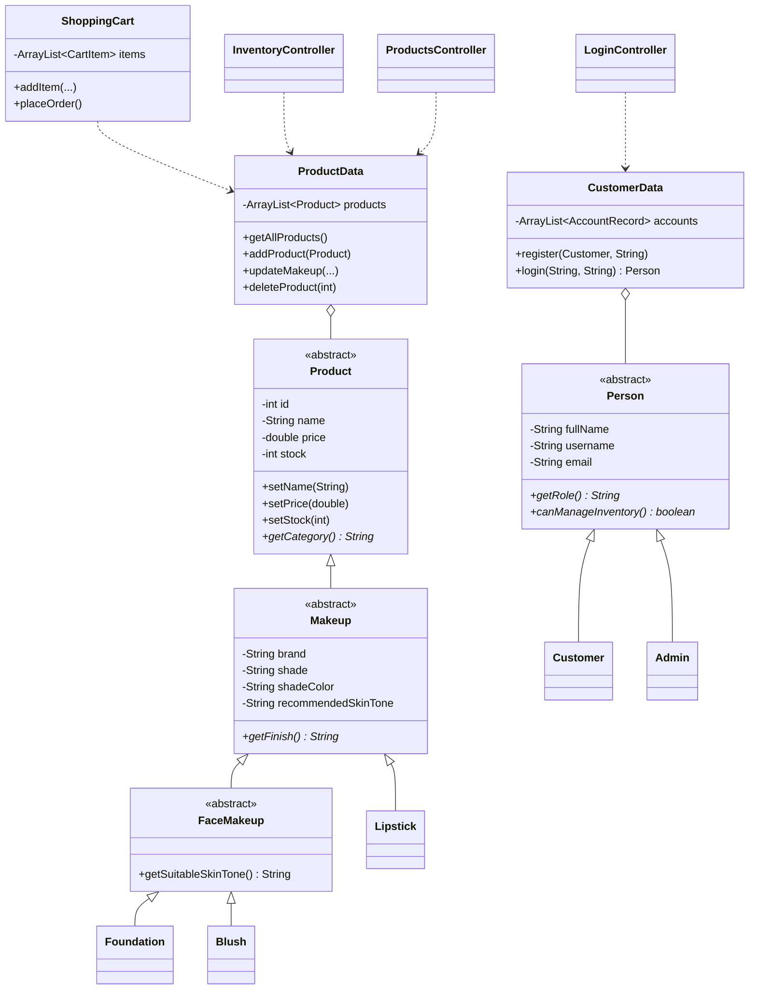

# Blush & Bloom – CLE Documentation (OOP in Java with JavaFX)

## 1. How to run
`mvn clean javafx:run` (main class `com.example.bandb.app.HelloApplication`).

**First launch:** the app creates the shop **admin** account and shows its random
password **once**. Write it down. Admin = extra "Manage Inventory" button (full CRUD).
Customers register from the login screen.

## 2. Package structure (guide: "separate packages")

| Package | Contents | Role |
|---|---|---|
| `app` | `HelloApplication`, `Launcher`, `SceneManager` | start-up + screen switching |
| `model` | `Product`, `Makeup`, `FaceMakeup`, `Foundation`, `Blush`, `Lipstick`, `Person`, `Customer`, `Admin` | logic / data (no JavaFX) |
| `service` | `ProductData`, `CustomerData`, `ShoppingCart`, `Session`, `SecureFiles` | ArrayLists + file storage |
| `controller` | `Login/Register/SkinTone/Home/Products/Inventory/Success` controllers, `CartWindow` | JavaFX controllers |
| `ui` | `FoundationPreview`, `BlushPreview`, `LipstickPreview` | custom JavaFX drawings |
| `resources/.../fxml` | all `.fxml`, `.css`, images | views |

## 3. Requirement checklist

| Requirement | Where |
|---|---|
| ≥ 4 model classes, inheritance ≥ 2 levels | `Product → Makeup → FaceMakeup → Foundation/Blush` (4 levels), `Makeup → Lipstick`, `Person → Customer/Admin` |
| ≥ 3 abstract classes | `Product`, `Makeup`, `FaceMakeup`, `Person` |
| `ArrayList<Parent>` with mixed subclasses | `ProductData.products` = `ArrayList<Product>` (Foundation + Blush + Lipstick together) |
| Full CRUD via JavaFX | `InventoryController` + `inventory.fxml` (TableView): Add / Update / Delete / read+search+sort. Cart also has add / change qty / remove |
| Input validation + friendly alerts | setters in `Product`/`Makeup`/`Person`; alerts in every controller |
| Separate packages | section 2 |
| Real-world theme | Beauty shop / e-commerce |
| Optional: search + Comparator | `InventoryController.currentSort()` + search box |
| Optional: file save/load | `.properties` files (products, customers, carts, orders) |
| Optional: summary dashboard | summary line on the Inventory screen (counts, stock, stock value) |

## 4. Four pillars – what to show in the code walkthrough

| Pillar | Show this | Say this |
|---|---|---|
| **Encapsulation** | `Product.java` (private fields, `setPrice`, `setStock`, `setName` validate); `Makeup.setShadeColor` (hex check); `Person.setEmail` | "Fields are private so nobody can store a negative price or a bad e-mail. Validation lives in the setter, once." |
| **Inheritance** | `Foundation`/`Blush` → `FaceMakeup` → `Makeup` → `Product`; each constructor calls `super(...)` | "Shared fields live in the parent; subclasses only add what is different." |
| **Polymorphism** | `ProductData.getAllProducts()` returns `ArrayList<Product>`; `InventoryController.setupColumns()` calls `getCategory()` / `getFinish()` on each object → Foundation "Natural", Blush "Soft", Lipstick "Cream". Also `Person.getRole()` / `canManageInventory()` for Customer vs Admin | "Same call, different behaviour per object type." |
| **Abstraction** | `Product.getCategory()` and `Makeup.getFinish()` are `abstract`; `Person` is abstract | "A generic Product/Person must never exist, only concrete ones. The abstract method forces every subclass to answer it." |

**ArrayList:** `ProductData.products`, `ShoppingCart.items`, `CustomerData.accounts`.
**Controller ↔ model:** controllers (e.g. `InventoryController.handleAdd`) build a model object via
`ProductData.create(...)` and call `ProductData.addProduct(...)`. They never contain business rules.

## 5. Customer data is private

* `CustomerData.accounts` is a `private` ArrayList. **No method returns it, a copy, or any other customer.**
  The only public methods are `register(...)` and `login(...)` (returns only the logged-in person's own profile).
* `Person` has **no password field**. Passwords exist only as a salted PBKDF2-SHA256 hash.
* `Admin` can manage products but has no way to read customers.
* Data files live in `~/BlushAndBloom/` (outside the project, so never committed to GitHub) and are
  restricted to the current OS user (`rwx------` / `rw-------`). `.gitignore` also blocks them.
* 5 wrong passwords lock that username for 60 s; unknown usernames take the same time as wrong passwords.
* Cart and order files are named by a hash of the username, never the plain name.

## 6. Why the buttons did not work (and the fix)

1. **Seven FXML files started with a blank line before `<?xml ...?>`** (`products`, `cart`, `cart-item`,
   `checkout`, `order-history`, `product-card`, `added-to-cart`). That is invalid XML, so JavaFX threw an
   exception when opening them: *Shop Products*, *My Cart*, *Checkout*, *Order History*, and every product card
   silently failed. Fixed (declaration is now the first line).
2. Screen-changing handlers threw `IOException` out of `@FXML` methods, so JavaFX swallowed the error and
   nothing happened. All page changes now go through `SceneManager.switchScene`, which shows an error alert.
3. A damaged `products.properties` crashed `ProductData` while the class was loading, which broke every shop button.
   It is now backed up and rebuilt from defaults.
4. The app forced **full-screen** on every page; pop-up windows (cart, alerts) can appear *behind* a full-screen
   window. It now starts maximized instead.

## 7. UML class diagram (paste into https://mermaid.live or GitHub to render)

## 8. Contribution table (fill in – use `git log --author` as evidence)

| Member | Main tasks | Classes / files worked on | Approx. % |
|---|---|---|---|
| Member 1 | | | |
| Member 2 | | | |
| Member 3 | | | |
| Member 4 | | | |

GitHub repo link: https://github.com/s2502421-prog/Oopro_CLE

## 9. Individual reflection (half page each)
1. Which OOP pillar did you work on most, and where is it in the code?
2. What was the challenging problem you faced, and how did you solve it?
3. What is one thing you would do differently next time?

## 10. Likely Q&A for this code
* **What would break if a field were public?** Anyone could call `product.price = -5` and skip the check in `setPrice`.
* **Why is `getCategory()` abstract?** Every concrete product must declare its category; a plain `Product` has no meaning.
* **Where does the controller call the model, and why not put logic in the controller?** `InventoryController.handleAdd` → `ProductData.create/addProduct`. Rules live in the model so every screen gets the same validation.
* **What if we remove an item while looping over a list?** `ConcurrentModificationException`; that is why `ProductData.getAllProducts()` returns a *copy* and `ProductData` uses `removeIf`/index removal.
* **Add a new subclass (e.g. `Eyeliner`)?** New class extends `Makeup` (implements `getCategory`, `getFinish`), add one `case` in `ProductData.create`, add the name to `categoryCombo` in `InventoryController`, and a preview in `ProductsController.createIllustration`.
